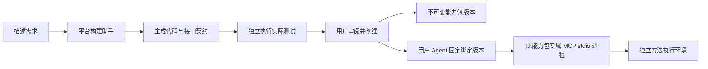

# 平台构建助手与生成能力包

入口是侧栏「创建 Agent」。默认打开平台维护的构建助手；原来的 MCP、Skill、知识库配置保留在「高级手动配置」。

## 使用流程

1. 可以先在「手动添加 / 管理 Skill」创建或导入工作方法，再描述目标、输入和希望得到的结果。构建助手先检查已有 Skill，并可组合文件、网络、浏览器基础能力。
2. 构建助手缺少规则时会提问。用户补充要求后继续生成。
3. 对相关 Skill 按需读取正文，方案显示直接/部分复用、理由与固定版本。缺少方法时可生成 Skill 草稿，用户审阅、编辑后选择「保存 Skill 并用于此 Agent」或「不采用」；未处理草稿不能发布。需要计算规则时，模型现场编写 Python 方法、输入输出 Schema 和合成测试。平台校验代码与契约，并在独立环境执行测试；失败时把实际结果交回模型修正一次。
4. 页面展示工作规则、所需基础能力和实际方法的测试结果。基础能力需逐项勾选授权。仅组合工具时明确显示配置校验，不冒充外部网站实测。校验通过后可「创建并使用」。样例通过代表这些样例成立，不代表业务正确性已被完全证明；创建前需核对规则。
5. 发布原子保存能力包、Agent 和 Skill 固定版本绑定，立即切换到新 Agent。仅复用 Skill 也可创建，不要求额外生成代码或开启基础工具。侧栏可自由切换原有 Agent。
6. 再次打开创建入口，可从「构建记录」查看、补充未发布方案，或选择基于已发布能力创建新版本。v2 创建新 Agent，旧 Agent 继续固定使用 v1。

内置示例「按类别汇总订单」使用合成数据，不读取 Notes、项目源码或知识库原文。生成阶段会发送这次构建对话、上一版方案、测试反馈和 Skill 用途目录给当前配置的模型；模型按需读取候选正文。不会在初始上下文预载全库正文。

## 架构与维护边界



- `agent_builds` 保存服务端草稿、对话、状态、修订号、测试报告与发布结果。关闭窗口不会取消正在运行的任务；记录保留后可重新打开。
- `capability_packages` 保存不可变版本，包含代码、契约、测试及 SHA-256。调用前重新检查版本哈希和 Agent 绑定。
- 每个 Agent 的每个能力包由独立 MCP stdio 实例提供方法。共用可信加载器，但不会把生成业务代码集中写进平台的单个 MCP 服务。
- SDK 只得到已绑定版本的方法白名单。生成方法调用进入现有 MCP 审计流程。
- 新版本重新生成并测试；旧版本不覆盖。并行基于同一版本发布时，后提交者需基于最新版本重新构建。
- 发布使用同一 SQLite 事务，避免只保存能力包或重复创建 Agent；重复发布返回同一个 Agent。
- 构建助手自身只开放内部只读 Skill 搜索和读取工具，没有文件、Shell 或外部 MCP 工具。此版本实现创建与切换，没有实现主 Agent 自动委派任务给其他 Agent。

## Skill 发现与复用

- 创建阶段可搜索当前个人工作区全部用户 Skill；运行阶段仍只能读取当前 Agent 绑定的版本，创建时的全库发现不会下放给生成的 Agent。
- 初始仅提供一页（最多 8 项）名称、用途和最新版本。`search_skills` 按名称用途匹配，可用简短关键词或空查询分页，每页最多 20 项、约 12000 字符；无语义检索，也不保证发现所有适用规则。
- `read_skill` 必须指定已发现的实际 ID 与版本。正文预算复用 `WORKBENCH_SKILL_READ_BUDGET_CHARS`，完整返回、不自动摘要，重复读取也占预算。
- 服务端只允许方案引用本次构建实际读取的版本；名称和用途取自数据库。没有读取正文的复用声明会交回模型修正，仍不符合则不能发布。
- 页面保留目录查询和实际读取版本记录。候选目录不冒充读取记录；配置校验不冒充任务执行验收。正文预览读取指定版本，历史方案不会跟随最新版本变化。
- 保存新 Skill 草稿需用户点击，允许修改名称、用途和 Markdown 正文。同名冲突不会覆盖已有规则；保存与方案引用在同一事务，过期修订或重复保存被拒绝。保存后草稿成为 Skill 库中的独立规则，即使未最终创建 Agent 也会保留。
- 发布将引用绑定到具体 Skill 版本，不复制正文进每个 Agent；运行时仍按任务读取。Skill 不授予工具权限，部分复用的缺口由方案说明，发布时将审阅的复用范围写入 Agent 工作规则，正文仍通过工具按需读取。
- 创建过程中新增或修改 Skill，不会静默改变已生成方案；通过「提交调整」让构建助手重新检查。老构建记录显示尚未做复用检查，需要重新生成。

## 方法运行环境

`python-stdlib-v1`：每个方法定义 `run(arguments)`，接收 JSON 对象并返回 JSON 对象。支持标准库 json、csv、math、statistics、datetime、decimal、re、collections、itertools、functools、string、unicodedata。没有自定义依赖、文件/网络/数据库连接和凭据注入。

此处描述生成方法的计算环境。文件、联网和浏览器通过独立的平台工具使用，详见 [平台基础能力](./platform-capabilities.md)。代码校验是辅助限制，操作系统隔离才是执行边界。环境不可用时不回退到后端直接执行。

- macOS：系统 `sandbox-exec` 默认拒绝访问，仅允许读取解释器、标准系统库和可信 worker；不能写文件或连接网络。净化环境变量；CPU 限额 2/3 秒，父进程最多等待 7 秒，并采样 RSS 超过 256 MiB 时停止。RSS 是采样保护，不是容器级硬内存隔离。
- Linux：需要可用 Docker 和预先准备好的官方 `python:3.11-slim` 镜像。容器无宿主挂载、无网络、根文件系统只读、无 capabilities，以非 root 用户执行，内存限制 256 MiB；worker 再设置 CPU/内存/文件描述符限制。当前开发机已验证 macOS 路径，Linux Docker 路径需在部署机验收。
- 每次输入连同代码最多 160,000 字节，输出最多 64 KiB。单包最多 6 个方法，每个方法 2–6 个合成测试；这些是生成/执行成本边界，不影响已实现的 Skill 数量规则。
- Schema 只允许基础类型及属性、数组、枚举、数值与长度约束；不允许外部引用、正则或组合表达式，避免后端验证器读取外部资源。

此功能面向现有本地个人工作区。对外多用户部署还需要账号、草稿/包/Agent 的所有权校验、配额与持久化任务队列，不能直接当作公网代码运行服务。

## API

| 接口 | 用途 |
| --- | --- |
| `GET /api/agent-builds/runtime` | 实际探测执行环境 |
| `GET /api/agent-builds/packages` | 已发布能力包最新版本摘要 |
| `GET /api/agent-builds` | 最近 30 条构建摘要 |
| `POST /api/agent-builds` | 使用客户端 UUID 幂等创建构建 |
| `GET /api/agent-builds/{id}` | 获取进度、对话、方案和报告 |
| `POST /api/agent-builds/{id}/messages` | 携带 expected_revision 补充需求 |
| `POST /api/agent-builds/{id}/skill-drafts/{index}` | 带 expected_revision，审阅保存或放弃 Skill 草稿 |
| `POST /api/agent-builds/{id}/publish` | 仅发布已通过测试且哈希匹配的方案 |

构建使用当前后端模型配置，每次模型生成限时 120 秒，最多生成两次；每轮方法测试设 40 秒预算，正在执行的单次方法仍受 7 秒超时约束。任务由当前后端进程运行；服务异常中断后超过 6 分钟的旧任务标记为可重试，过期任务不能覆盖新修订。这不是持久化分布式任务队列。

## 验证

```sh
cd backend
.venv/bin/python -m unittest discover -s tests -q
# 在宿主环境额外验证实际隔离与 stdio MCP（嵌套工具沙箱会阻止 sandbox-exec 启动）
WORKBENCH_RUN_SANDBOX_TESTS=1 .venv/bin/python -m unittest discover -s tests -p test_agent_builder.py -q
cd ../frontend
npm test
npm run build
```

测试覆盖真实测试失败拦截、澄清和修订、发布幂等、事务回滚、版本固定与并发冲突、哈希/绑定校验、危险代码/Schema 拒绝，以及实际 stdio MCP 调用、文件读写与网络拒绝、循环终止及凭据不继承。


2026-10-19 Skill 复用验收：真实模型发现并读取「需求拆解 v2」，创建仅绑定该 Skill 的「项目需求整理 Agent · v1」，后续对话实际按需读取 v2；以虚构待办需求验证输出，无代码巡检声明。独立临时数据库验收部分复用、草稿 Markdown 预览、编辑保存、创建后两个固定绑定；未把合成 Skill 写进用户数据库。

可重复运行独立页面验收（合成生成器，不调用外部模型）：

```sh
cd frontend
VITE_API_BASE_URL='' npm run build -- --outDir ../backend/data/platform-validation/skill-ui-dist
cd ../backend
.venv/bin/python tests/builder_skill_validation_server.py
# http://127.0.0.1:8088/
```
