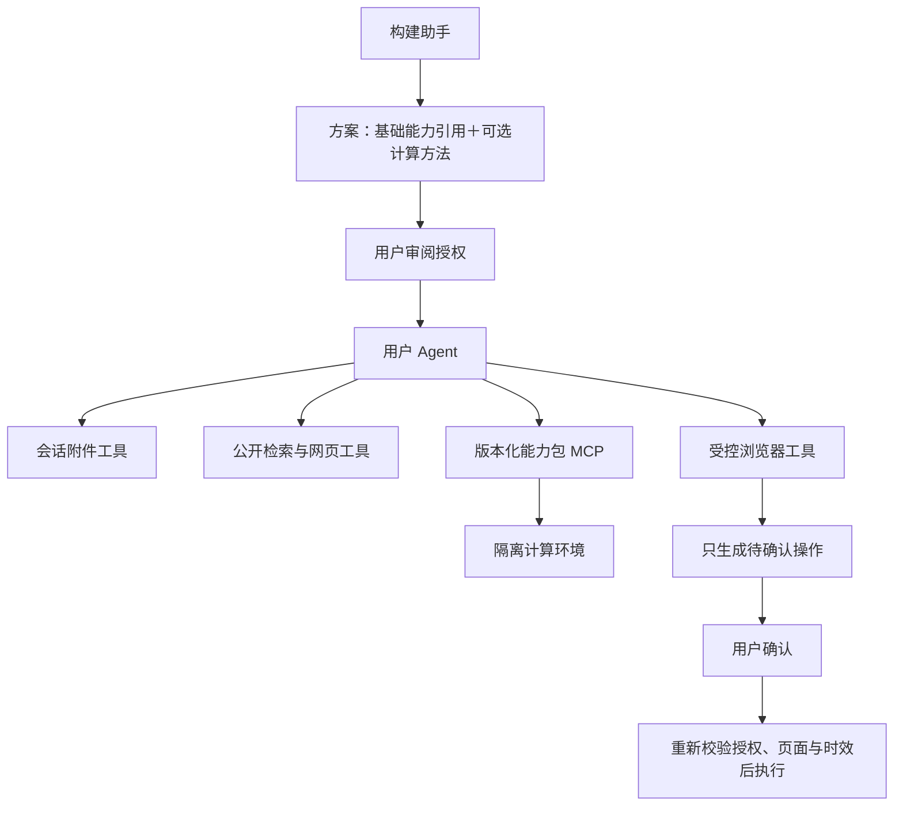

# 平台基础能力：文件、网络与受控浏览器

构建助手现在可以组合基础能力，并在需要时生成计算方法。生成代码仍在独立计算环境运行，不直接获得文件、网络或浏览器权限。

## 使用

1. 点击「创建 Agent」描述目标。构建助手会列出所需的基础能力，审阅并勾选后才能创建。
2. 已有 Agent 可通过对话顶部「基础能力」单独启用或撤销文件、网络、浏览器工具；从下一轮生效，每次工具调用与批准执行也会重新检查授权。
3. 文件能力启用后，聊天输入区出现「添加附件」。支持 PDF、DOCX、TXT、MD、CSV、JSON，单个不超过 2 MB，每个会话最多 50 份、总量 20 MB。上传后可预览解析文字，刷新和历史会话恢复时附件仍保留。
4. 让 Agent 搜索公开网页并核对原始页面。工具返回实际来源 URL、摘要/正文和检索时间；搜索可能限流，失败会明确返回错误。
5. 让 Agent 打开网页，或在「浏览器与登录」面板输入公开网址。可查看预览、刷新、关闭浏览器。
6. 登录或验证由用户在本机独立浏览器中接手。面板点击「接手操作（60 秒）」后，允许用户操作当前站点，Agent 暂停读取和规划；「交回 Agent」后可继续读取页面。无桌面的服务器不能直接接手，需另行提供远程桌面环境。
7. Agent 准备填表、选择、勾选、上传或点击时，聊天中出现操作确认卡片，列出接收网站、字段、内容、文件及按钮。确认后才执行；取消不执行。提交是否成功以页面回执为准。

秋招示例：上传简历 → 提取技能与意向 → 使用非敏感关键词搜索岗位 → 读取岗位原文 → 解释推荐理由 → 打开职位页面 → 准备申请操作清单 → 用户确认 → 核对回执。平台不保证适配所有招聘网站，不自动绕过登录或验证码，也不承诺无人监管批量投递。

## 能力边界

| 能力 | 已实现 | 当前限制 |
| --- | --- | --- |
| 文件 | 会话附件原始文件与解析文字持久化、分页读取、DOCX 表格、PDF 文字提取 | 不扫描本机目录；不支持旧 DOC、扫描件 OCR 或任意压缩包 |
| 网络 | DDGS 公开搜索、网页正文与链接、来源及时间、分页 | 搜索服务和网络可能受限；静态读取不能执行动态页面脚本；不能访问本机/内网 |
| 浏览器 | 独立 Chromium 会话、真实元素快照、预览、用户接手、确认后填表/上传/点击 | 跨站导航需重新打开；提供资料后的第三方资源受限；复杂 SSO、iframe、验证码或强反自动化网站可能需要用户处理 |
| 生成方法 | 根据业务规则编写、独立测试与固定版本 | 只计算 JSON 数据；I/O 由授权的平台工具完成 |

基础能力仅配置 Agent 的可用工具，用户上传及网页中出现的内容都不能扩大授权。撤销能力不会抹除模型已经看过的会话历史。

## 架构



基础工具分成文件、网络、浏览器模块，由受信任的 `workbench_platform` MCP 注册层按 Agent 授权装配。生成业务方法继续使用独立、不可变的能力包及专属 stdio MCP，未合并到基础工具中。

附件只接受上传字节与生成 ID，不接受模型传入宿主路径。文件按会话校验，原文件用于经确认的上传，正文供模型分页读取。解析在独立子进程中进行，净化环境、限制 CPU、页数、解压规模和超时；macOS 额外使用 OS 文件/网络隔离及 RSS 采样限制，Linux 使用子进程资源限制，尚非独立解析容器。

网页请求在连接前解析域名并检查所有地址为公网，再将已验证 IP 交给 socket，保留原始域名进行 TLS 验证。每次重定向重新校验。限制端口、响应大小及超时，不接受任意认证头、代理或 Cookie。搜索摘要不代表已读原文；搜索结果也会过滤非公网 URL。

浏览器由独立事件循环线程管理，使用全新临时上下文，不连接个人 Chrome，也不保存持久登录配置。HTTP 请求经同一公网网关转发，拦截未经确认的写请求、跨站导航、弹窗和下载；提供资料后拦截跨站资源。WebSocket 与实时传输入口禁用。它是本地受控浏览器原型，公网多租户运行仍需要独立容器、网络出口与账户隔离。

所有页面操作都使用实际快照的元素 ID；页面变化、快照失效、5 分钟审批到期、会话失效或能力撤销都会阻止执行。相同待确认清单复用审批记录；审批状态使用条件更新，重复确认返回 409，不会重复执行。执行中断会提示部分操作可能已经发生，不能自动重试或假称失败前没有发送任何内容。

## 安装与部署

安装后端依赖，然后单独准备浏览器（工作台不会在请求中自动下载）：

```sh
cd backend
.venv/bin/python -m pip install -r requirements.txt
PLAYWRIGHT_BROWSERS_PATH="$PWD/data/browsers" .venv/bin/python -m playwright install chromium
```

macOS 默认显示独立浏览器窗口，Linux 默认无头运行。Dockerfile 已增加浏览器及系统依赖准备，镜像体积会增大；当前开发机没有可运行 Docker daemon，Docker 路径尚未验收。Docker 无桌面环境时只能预览，不能直接完成用户接手登录。

本地默认仅接受 localhost、127.0.0.1、testserver、backend 的 Host，防止恶意域名重新指向本地 API。部署到自己的域名时配置 `WORKBENCH_TRUSTED_HOSTS` 与 `WORKBENCH_CORS_ORIGINS`。当前仍是单个个人工作区，没有账号级数据隔离，不应直接暴露为公网简历/浏览器服务。

文件与能力配置保存在 SQLite；浏览器登录态仅在进程内存在。浏览器资源、运行数据库和合成验证文件不提交到仓库。服务重启后浏览器会话需重新打开。

实现依据：[Playwright 安装与浏览器](https://playwright.dev/python/docs/library)、[pypdf 文字提取](https://github.com/py-pdf/pypdf/blob/main/docs/user/extract-text.md)、[DDGS 包说明](https://pypi.org/project/ddgs/)。

## 验证

```sh
cd backend
WORKBENCH_RUN_SANDBOX_TESTS=1 .venv/bin/python -m unittest discover -s tests -q
# 真实浏览器合成验收，另开窗口后用页面按钮操作
.venv/bin/python tests/browser_validation_server.py
# http://127.0.0.1:8087/
cd ../frontend
npm test
npm run build
```

浏览器验收服务使用独立数据库和仅允许访问本地合成表单的测试注入，不由生产应用加载。确认前提交数为零，确认后填写合成姓名、技能、上传合成 DOCX 并得到 TEST-RECEIPT-1；重复确认被拒绝，提交数仍为一。没有向任何企业网站发送申请。
