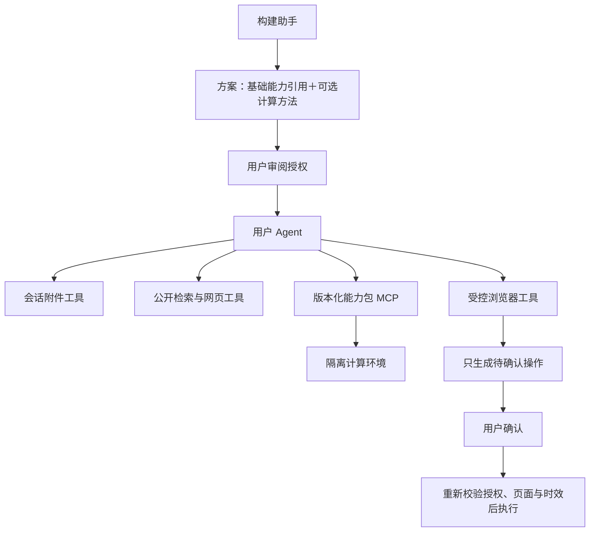

# 平台基础能力：文件、网络与受控浏览器

构建助手现在可以组合基础能力，并在需要时生成计算方法。生成代码仍在独立计算环境运行，不直接获得文件、网络或浏览器权限。

记录、定期状态检查以及单个本机文件版本更新现已接入，详见 [执行记录与文件恢复](./execution-tracking.md)。

macOS 本机现默认使用官方 MCP 专用浏览器，正常联网并保留对话专用登录，详情见 [本机浏览器与审批](./native-browser.md)。`legacy` 为旧公网网关原型，两者网络和登录行为不同。

## 使用

1. 点击「创建 Agent」描述目标。构建助手会列出所需的基础能力，审阅并勾选后才能创建。
2. 已有 Agent 可通过对话顶部「基础能力」单独启用或撤销文件、网络、浏览器工具；从下一轮生效，每次工具调用与批准执行也会重新检查授权。
3. 文件能力启用后，聊天输入区出现「添加附件」。支持 PDF、DOCX、TXT、MD、CSV、JSON 和 PNG、JPG、WEBP 图片，单个不超过 2 MB，每个会话最多 50 份、总量 20 MB。上传后可预览解析文字，刷新和历史会话恢复时附件仍保留。
   图片和扫描版 PDF（提取不到文字的 PDF，取前 10 页）上传后出现在输入框上方的「随消息发送」，随下一条消息放进用户消息交给模型，之后几轮仍在历史中；每条消息最多 5 个、共 20 张图。需要支持图片输入的模型（例如 `deepseek-v4-flash`），否则发送时提示更换模型。图片在沙盒中校验，并缩小到长边 1568 像素后才交给模型。
4. 让 Agent 搜索公开网页并核对原始页面。工具返回实际来源 URL、摘要/正文和检索时间；搜索可能限流，失败会明确返回错误。
5. 让 Agent 打开网页，或在「浏览器与登录」面板输入公开网址。可查看预览、刷新、关闭浏览器。
6. 登录或验证由用户在后端电脑的专用 Chrome 接手。点击「接手操作 / 续期（5 分钟）」后 Agent 暂停读取和规划；交回后继续。native_mcp 的计时不控制网页网络，截图由用户手动刷新。无桌面的服务器不能直接接手。
7. Agent 准备填表、选择、勾选、上传或点击时，聊天中出现操作确认卡片，列出接收网站、字段、内容、文件及按钮。确认后才执行；取消不执行。提交是否成功以页面回执为准。

秋招示例：上传简历 → 提取技能与意向 → 使用非敏感关键词搜索岗位 → 读取岗位原文 → 解释推荐理由 → 打开职位页面 → 准备申请操作清单 → 用户确认 → 核对回执。平台不保证适配所有招聘网站，不自动绕过登录或验证码，也不承诺无人监管批量投递。

## 能力边界

| 能力 | 已实现 | 当前限制 |
| --- | --- | --- |
| 文件 | 会话附件原始文件与解析文字持久化、分页读取、DOCX 表格、PDF 文字提取；图片与扫描版 PDF 随用户消息交给支持图片的模型 | 可由用户明确关联单个本机文件，不扫描目录；不支持旧 DOC 或任意压缩包；图片只能随用户消息提供，模型不能用工具自行查看（DeepSeek 对工具结果中的图片识别不可靠）；压缩历史时图片换成文字说明 |
| 网络 | DDGS 公开搜索、网页正文与链接、来源及时间、分页 | 搜索服务和网络可能受限；静态读取不能执行动态页面脚本；不能访问本机/内网 |
| 浏览器 | native_mcp 使用官方工具、专用 Chrome 持久配置、正常网站网络、手动截图及平台确认；legacy 保留旧会话模式 | Agent 跨站读取需重新核对；复杂 SSO、验证码和自定义控件可能需接手；当前仅本机个人工作区 |
| 生成方法 | 根据业务规则编写、独立测试与固定版本 | 只计算 JSON 数据；I/O 由授权的平台工具完成 |

基础能力仅配置 Agent 的可用工具，用户上传及网页中出现的内容都不能扩大授权。撤销能力不会抹除模型已经看过的会话历史。

## 架构



基础工具分成文件、网络、浏览器模块，由受信任的 `workbench_platform` MCP 注册层按 Agent 授权装配。生成业务方法继续使用独立、不可变的能力包及专属 stdio MCP，未合并到基础工具中。

附件只接受上传字节与生成 ID，不接受模型传入宿主路径。文件按会话校验，原文件用于经确认的上传，正文供模型分页读取。解析在独立子进程中进行，净化环境、限制 CPU、页数、解压规模和超时；macOS 额外使用 OS 文件/网络隔离及 RSS 采样限制，Linux 使用子进程资源限制，尚非独立解析容器。

网页请求在连接前解析域名并检查所有地址为公网，再将已验证 IP 交给 socket，保留原始域名进行 TLS 验证。每次重定向重新校验。限制端口、响应大小及超时，不接受任意认证头、代理或 Cookie。搜索摘要不代表已读原文；搜索结果也会过滤非公网 URL。

浏览器由独立事件循环线程管理，按 `WORKBENCH_BROWSER_PROVIDER` 选择后端。macOS 默认 native_mcp：官方 MCP stdio 与普通 Chrome，按对话保留专用登录，网站正常联网，Agent 动作仍走平台审批。它不沿用旧公网网关的逐请求限制，也不代表网页不会自动保存或发出跨域请求。其他环境默认 legacy：临时上下文、公网网关转发及旧资源限制，仍可用 WORKBENCH_BROWSER_CHANNEL 选择执行程序。两者都不连接个人 Chrome；公网多用户部署需要另行实现执行、网络出口和账户隔离。

所有页面操作都使用实际快照的元素 ID；页面变化、快照失效、5 分钟审批到期、会话失效或能力撤销都会阻止执行。相同待确认清单复用审批记录；审批状态使用条件更新，重复确认返回 409，不会重复执行。执行中断会提示部分操作可能已经发生，不能自动重试或假称失败前没有发送任何内容。

## 安装与部署

安装后端依赖。macOS 新方案另需 Node.js 18+ 和普通 Google Chrome，运行 `.venv/bin/python scripts/install_browser_mcp.py` 安装固定版本官方组件。legacy 服务器可准备 Chromium（不会在请求中自动下载）：

```sh
cd backend
.venv/bin/python -m pip install -r requirements.txt
PLAYWRIGHT_BROWSERS_PATH="$PWD/data/browsers" .venv/bin/python -m playwright install chromium
```

macOS 默认显示独立浏览器窗口，Linux 默认无头运行。Dockerfile 已增加浏览器及系统依赖准备，镜像体积会增大；当前开发机没有可运行 Docker daemon，Docker 路径尚未验收。Docker 无桌面环境时只能预览，不能直接完成用户接手登录。

本地默认仅接受 localhost、127.0.0.1、testserver、backend 的 Host，防止恶意域名重新指向本地 API。部署到自己的域名时配置 `WORKBENCH_TRUSTED_HOSTS` 与 `WORKBENCH_CORS_ORIGINS`。当前仍是单个个人工作区，没有账号级数据隔离，不应直接暴露为公网简历/浏览器服务。

文件与能力配置保存在 SQLite。native_mcp 登录保存在当前对话的专用配置中，legacy 登录只在临时会话存在；服务重启后均需重新打开窗口，旧审批不能恢复。浏览器配置、运行数据库和合成验证文件不提交到仓库。

实现依据：[Playwright 安装与浏览器](https://playwright.dev/python/docs/library)、[pypdf 文字提取](https://github.com/py-pdf/pypdf/blob/main/docs/user/extract-text.md)、[DDGS 包说明](https://pypi.org/project/ddgs/)。

## 验证

```sh
cd backend
WORKBENCH_RUN_SANDBOX_TESTS=1 .venv/bin/python -m unittest discover -s tests -q
# 真实浏览器合成验收，另开窗口后用页面按钮操作
.venv/bin/python tests/browser_validation_server.py
# http://127.0.0.1:8087/
cd ../frontend
npm test
npm run build
```

浏览器验收服务使用独立数据库和仅允许访问本地合成表单的测试注入，不由生产应用加载。确认前提交数为零，确认后填写合成姓名、技能、上传合成 DOCX 并得到 TEST-RECEIPT-1；重复确认被拒绝，提交数仍为一。没有向任何企业网站发送申请。


## 2026-10-20：浏览器选择与框架按钮

- 默认 `WORKBENCH_BROWSER_CHANNEL=auto`，优先选择已安装的普通 Google Chrome，未安装时使用已准备的 Chromium。显式选择缺失的浏览器会提示安装或改配置，不静默换回其他浏览器。界面显示当前会话实际使用的名称。
- `chrome` 与 `msedge` 使用 Playwright 官方 channel；不指定个人资料路径、不连接已有个人浏览器。切换或重启后重新打开并登录，原会话不会迁移。
- 快照覆盖原生控件、ARIA button/link、带实际 DOM 点击处理函数的紧凑控件，以及具有指针样式的 div/span/li 控件；不读取框架内部状态。过滤不可见节点后再限制返回 250 个，列表超出时返回 `elements_truncated`。
- 嵌套文字继承父按钮的指针样式时不重复生成按钮；普通说明文字不冒充控件，禁用或 inert 控件不能准备点击。可读取开放 Shadow DOM，跨站 iframe 和画布控件仍不在本版支持范围内。
- 准备与执行继续绑定最新快照、实际元素句柄与页面指纹，自定义按钮也参与指纹计算；生成清单不执行点击，执行仍需确认。

验收：普通 Chrome 的合成页包含 180 个隐藏链接、框架 div 按钮、ARIA 按钮、事件委托 span 与禁用控件。目标得到唯一 ID，确认前计数 0，确认后为 1。金证科技公开岗位页的真实「立即投递」div 已获得 ID、clickable=true、disabled=false，并成功生成只读操作方案，未实际点击或发送简历。后端 232 项、前端 52 项与生产构建通过。

## 2026-10-20：当前操作预览

- 启用浏览器能力的对话打开页面后，自动显示「当前操作预览」。桌面位于对话右侧，窄屏布局位于对话上方；顶部同名入口可重新展开。
- 页面可见时每两秒更新画面，切换会话取消旧请求；放大预览时暂停侧栏画面请求。显示更新时间、当前网址，以及执行中、完成或中断状态。网络失败会明确标记旧画面。
- 确认清单的每一步都有「预览此步」，显示当前真实控件的位置。「定位此控件」仅滚动到该控件，不点击、不填表。页面变化、接手、清单过期或执行中时，不继续标记旧目标。
- 「放大预览 / 浏览器管理」保持当前所选页面；多个浏览器可以切换查看。清单关联页面已关闭时提示重开，不替换成另一个无关页面。
- 预览是只读截图，不是可输入的远程桌面。登录请点击「接手登录」，切换至后端电脑上的独立 Chrome；无可见窗口时禁用接手。聊天回复“确认”不能代替网页「确认执行以上操作」按钮。
- 预览接口重新检查会话、能力授权与清单所属页面，响应不缓存、不持久化截图，也不重新生成页面快照，因此不会因定时刷新使待确认清单失效。只读截图可以在已批准的操作执行期间读取；主动定位与执行互斥。

验收：本地合成表单逐步预览、滚动定位、批准后回执画面和放大预览通过，真实公开岗位页可显示实时画面；没有实际投递。自动化验证执行期间仍可读取画面、过期目标失效、跨会话隔离与能力撤销。后端 238 项、前端 56 项测试及生产构建通过。

## 2026-10-20：登录页空白与预览断线恢复

- 修复纯导航点击被误记为已提供个人资料，导致登录页新加载的跨站静态脚本被拦截。填写、选择、勾选、上传前才设置资料标记；用户接手登录仍标记为敏感，已有标记不清除。跨站跳转、未授权写入和提供资料后的跨站资源限制保留。
- 资源拦截现在返回实际原因，不再静默失败。预览区分目标网页没有正文和预览连接失败；空白页面不会被解释为业务成功。
- 浏览器窗口关闭时清除失效会话。预览请求最多等待八秒，失败后仍可聊天和重试；切换会话取消旧请求，响应缺失必要字段不会进入渲染。页面失效后显示恢复入口，管理面板保留刚才的网址，需用户点击重新打开，不自动重复操作或恢复旧登录状态。

验收：合成导航点击后依靠另一个本机 origin 的脚本渲染登录页成功，确认没有填写资料、提交数为零；此前同一触发条件会导致脚本被限制。真实金证科技登录页能显示登录界面，未输入账号、验证码或上传简历。后端 249 项、前端 60 项测试及生产构建通过。

## 2026-10-20：接手后返回或刷新白屏

上述修复只覆盖接手前的纯导航。接手后保留资料保护标记，返回或刷新岗位页仍会拦截跨站脚本，造成主文档 200、正文为空。现在每个浏览器会话在提供资料前缓存已成功读取的公开跨站脚本、样式、字体、图片及静态文件（JSON 文件、通过 fetch/XHR 读取的 HTML 组件模板）；接手后仅按完全相同的网址及资源类型从内存重放，不发出新的跨站请求，不重放响应 Cookie。新地址、变化的查询参数、动态接口、主网页 HTML 和标记 no-store 的响应不在此范围内，继续执行原有网络规则。

缓存限 128 项、共 16 MB，关闭或重启即清除。不清除资料标记，不允许任意 CDN 或接口。尚未事先加载的依赖仍可能受限，不能保证所有登录或跨站流程适配。管理面板新增「重新加载网页」，使用当前站点的 GET 导航并使旧清单失效；用户接手期间须先交回，不重放表单 POST。

合成对照：清空缓存后接手刷新正文为空；保留缓存后完成岗位→登录→接手→交回→返回岗位→刷新，正文正常、新跨站请求零次、业务提交零次。扩展场景覆盖脚本、fetch JSON、SVG 和 HTML 组件，返回和刷新共命中缓存八次。真实原岗位页完成接手、交回和重新加载验证，正文与 Logo 可见，加载失败提示消失；未执行真实账号登录或投递。页面资源详情提供域名、类型、方法和缓存分类，避免把所有失败都当成网站封禁。后端 257 项、前端 60 项测试及构建通过。

## 2026-10-20：新页面依赖与页面连接确认

此前缓存仅覆盖已访问过的资源，接手后从岗位点击进入登录页，首次加载的登录脚本仍被拦截。新增「浏览器与登录 → 页面连接」，列出当前页面实际被拦的请求；所有选项默认不勾选。加载请求和可能发送资料的请求分开审阅：

- GET 资源按完整地址（含查询参数）、方法和当前浏览器会话授权十分钟；匿名转发，移除 Cookie、认证头、自定义令牌、Referer 和请求体，移除响应 Cookie。网址参数仍会传给目标站点。确认按钮明确包含重新加载；接手期间只授权，交回后再加载。
- POST 等发送连接还需勾选独立的数据发送确认。授权连接不重试任何历史请求，仅在用户接手或执行已批准的操作时允许发送。不能把日志 POST 直接当作投递接口；授权连接也不代表投递已提交。
- 目标保持公网校验和 DNS 防护，不允许跨站页面导航；模型工具不能授予连接权限。会话、当前页面、待审请求 ID 都需一致。授权、撤销或到期会使旧操作清单失效；关闭会话即清除授权。撤销停止后续请求，不能撤回已发送内容或抹去已显示的公开缓存。
- 审计仅记录方法和域名，不写入完整查询参数、请求体或凭据。预览和模型输出提供待审数量与恢复指引。

后端 268 项测试、前端 60 项测试与生产构建通过。公开站点使用全新无账号会话，实测岗位→接手交回→确认点击「立即投递」→`/login` 白屏→审阅四个 acdn.bstatics.com 脚本/样式及一个 portal-oss.zhiye.com 图片 GET→重新加载→出现「欢迎登录」和扫码入口。两个 `/api/frontend/logs` POST 始终未授权，说明它们被拦不能直接作为投递流程无法继续的依据。没有输入账号、验证码、上传文件或提交申请；实际账号登录后的表单和提交仍待用户验收。

## 2026-10-20：预览截图干扰与接手到期

用户确认独立 Chrome 也闪烁，收起所有预览、停止定时截图后闪烁消失。原 `page.screenshot()` 会准备并恢复页面输入框样式；现在 Chromium 预览直接读取 compositor surface，不注入样式，不隐藏光标，不改变 viewport，不调用截图前后的页面准备逻辑。同会话多个预览共用捕获锁和半秒短缓存。用户接手期间不截图、不读取 DOM，仅返回交接前的内存画面，显示暂停状态和真实拍摄时间。

公开招聘站按钮源码显示：登录后先 POST `/api/Submission/CheckJobAd`，成功后导航到 `/form`，这一步不是最终投递。接手到期后，同站 POST 也会被平台阻止；原诊断仅保留最早十条，容易被重复日志占满。现改为最近二十条去重记录，保留路径而不保留查询参数，单独显示手动操作被阻止的提示，不静默丢失后来的业务校验错误。

网页接手按钮明确改为「接手操作 / 续期（5 分钟）」，由用户点击后生效，可续期；接口兼容旧调用默认六十秒，严格限制三十至六百秒。预览显示剩余秒数与到期提示，交回立即停止手动发送权限，Agent 仍须生成具体操作清单后获批执行。不会自动续期、重试请求、批准跨站连接或提交申请。

新增回归覆盖接手期间所有截图入口与 DOM 读取暂停、并发预览合并、时长校验、到期岗位校验阻止及最新错误可见。后端 273 项、前端 60 项测试通过。

普通 Chrome 合成验收：实时预览持续读取后，输入框样式变化计数为零、窗口 resize 计数为零；接手后显示五分钟倒计时、拍摄时间保持不变，交回后恢复预览。生成清单时岗位校验次数为零，确认执行后实际进入合成填写页，岗位校验恰好一次、业务提交零次。真实招聘站已登录后的填写流程仍需重新登录验收，未将合成验收记为真实投递成功。

## 项目代码（只读）

在 Agent 的“基础能力”里勾选“项目代码”，并填写后端所在电脑上的项目目录完整路径（每个 Agent 最多 3 个，绑定立即保存）。之后 Agent 可以：

| 工具 | 作用 | 上限 |
| --- | --- | --- |
| `code_projects` | 列出绑定的项目 ID | — |
| `code_list` | 列目录（depth 1–3） | 500 项 |
| `code_search` | 文本或正则搜索，可按 glob / path 缩小 | 50 条、5 秒 |
| `code_read` | 按行读取，带行号 | 单次 400 行，文件 1 MB |
| `code_outline` | Python / TS / JS 的类和函数及行号 | — |

边界（`backend/app/platform/code.py`）：

- 模型只能传项目 ID 和项目内相对路径；绝对路径、`~`、`..` 被拒绝，符号链接解析后必须仍在项目内（指向外部的链接不会出现在列表和搜索里）。
- git 仓库用 `git ls-files` 的结果，遵守 `.gitignore`；非 git 目录跳过隐藏目录和 `node_modules`、`.venv`、`dist` 等依赖/构建目录。
- `.env`（`.env.example` 等模板除外）、私钥、证书、`.netrc`/`.npmrc`、`credentials*.json`、`secrets.*`、数据库文件不可见。
- 返回的代码先遮盖疑似密钥的字符串字面量和常见令牌格式，再做平台通用的个人信息脱敏。二进制文件不读取。
- 不能修改、执行代码，也不能运行命令。不能绑定根目录或整个用户目录。
